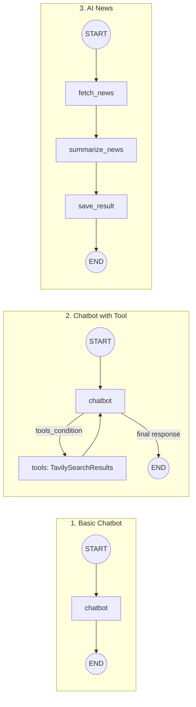

# LangGraph Agentic AI

An end-to-end stateful Agentic AI web application built with **LangGraph**, **LangChain**, **Groq**, **Tavily**, and **Streamlit**. It provides a modular graph-based architecture supporting standard conversational AI, web-search tool-augmented reasoning, and automated AI news aggregation and summarization.

---

## Key Features

- **Basic Chatbot** — Stateful conversational agent powered by Groq-hosted LLMs (`START -> chatbot -> END`).
- **Chatbot with Tool** — Tool-calling agent integrated with `TavilySearchResults` (`max_results=2`) and LangGraph's `ToolNode` / `tools_condition` routing loop for live web search.
- **AI News Explorer** — Automated multi-step news pipeline (`fetch_news -> summarize_news -> save_result -> END`) that:
  - Fetches recent AI technology news via `TavilyClient` across **Daily**, **Weekly**, or **Monthly** timeframes.
  - Summarizes and sorts articles by date (IST, `YYYY-MM-DD`) with source links using the selected Groq LLM.
  - Saves reports to `AINews/<timeframe>_summary.md`, renders them in the UI, and offers one-click Markdown download.
- **Configurable UI** — Model and use-case options are centrally managed via [uiconfigfile.ini](src/langgraphagenticai/ui/uiconfigfile.ini).

---

## Architecture & Graph Workflows

The application entry point (`app.py`) invokes `load_langgraph_agenticai_app()` in `src/langgraphagenticai/main.py`, which loads sidebar controls, initializes the Groq LLM, compiles the selected LangGraph workflow in `GraphBuilder`, and renders outputs through `DisplayResultStreamlit`.



---

## Project Structure

```text
.
├── .github/
│   └── workflows/
│       └── main.yml                          # GitHub Actions workflow to sync to Hugging Face Spaces
├── AINews/
│   └── daily_summary.md                      # Generated Markdown news summaries
├── src/
│   └── langgraphagenticai/
│       ├── LLMS/
│       │   └── groqllm.py                    # Groq LLM client configuration
│       ├── graph/
│       │   └── graph_builder.py              # LangGraph StateGraph builders per use case
│       ├── nodes/
│       │   ├── basic_chatbot_node.py         # Basic chatbot graph node
│       │   ├── chatbot_with_Tool_node.py     # Tool-bound chatbot graph node
│       │   └── ai_news_node.py               # News fetch, summarization, and save nodes
│       ├── state/
│       │   └── state.py                      # TypedDict graph state with add_messages reducer
│       ├── tools/
│       │   └── serach_tool.py                # Tavily search tool & ToolNode factory
│       ├── ui/
│       │   ├── uiconfigfile.ini              # Page title, LLM, model, and use-case options
│       │   ├── uiconfigfile.py               # ConfigParser wrapper
│       │   └── streamlitui/
│       │       ├── loadui.py                 # Streamlit sidebar & session initialization
│       │       └── display_result.py         # Stream/invoke execution & UI rendering
│       ├── vectorstore/                      # Reserved for vector store integrations
│       └── main.py                           # Application orchestration
├── app.py                                    # Streamlit entry point
├── requirements.txt                          # Python dependencies
└── README.md
```

---

## Prerequisites

- **Python** 3.10+
- **Groq API Key** — Required for all use cases ([Groq Console](https://console.groq.com/keys))
- **Tavily API Key** — Required for **Chatbot with Tool** and **AI News** ([Tavily](https://app.tavily.com/home))

---

## Getting Started (Local Setup)

> **Note:** Run all commands from the directory containing `app.py`, since configuration (`./src/langgraphagenticai/ui/uiconfigfile.ini`) and news output (`./AINews/`) use relative paths.

### 1. Create and Activate a Virtual Environment

**Windows (PowerShell):**
```powershell
python -m venv .venv
.\.venv\Scripts\Activate.ps1
```

**macOS / Linux:**
```bash
python3 -m venv .venv
source .venv/bin/activate
```

### 2. Install Dependencies

```bash
pip install -r requirements.txt
```

### 3. Run the Application

```bash
streamlit run app.py
```

Open the local URL displayed in the terminal (default: `http://localhost:8501`).

---

## Usage

1. **Select LLM & Model:** In the sidebar, keep **Groq** selected, choose one of the configured models (`mixtral-8x7b-32768`, `llama3-8b-8192`, `llama3-70b-8192`, `gemma-7b-i`), and paste your **Groq API Key**.
2. **Select a Use Case:**
   - **Basic Chatbot:** Enter a prompt in the chat input at the bottom.
   - **Chatbot with Tool:** Enter your **Tavily API Key** in the sidebar, then ask questions requiring live web information.
   - **AI News:** Enter your **Tavily API Key**, select a timeframe (**Daily**, **Weekly**, or **Monthly**), and click **Fetch Latest AI News** to generate, preview, and download the Markdown summary.

---

## Configuration

Update [uiconfigfile.ini](src/langgraphagenticai/ui/uiconfigfile.ini) to customize the page title, available LLM options, Groq model list, or use-case names:

```ini
[DEFAULT]
PAGE_TITLE = LangGraph: Build Stateful Agentic AI graph
LLM_OPTIONS = Groq
USECASE_OPTIONS = Basic Chatbot, Chatbot with Tool, AI News
GROQ_MODEL_OPTIONS = mixtral-8x7b-32768, llama3-8b-8192, llama3-70b-8192, gemma-7b-i
```

---

## Deployment

This repository includes a GitHub Actions workflow at [.github/workflows/main.yml](.github/workflows/main.yml) that pushes the `main` branch to Hugging Face Spaces using an `HF_TOKEN` repository secret.

---

## License

This project is licensed under the **Apache License 2.0** (see the Space metadata header above).
